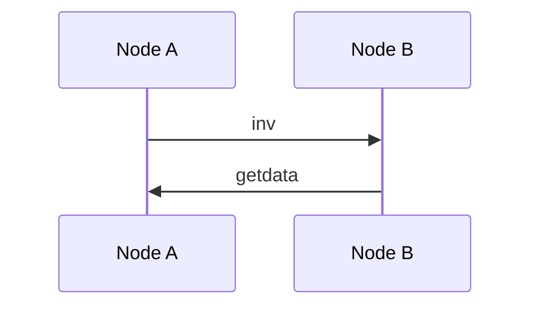

---
# Copy this file to _wiki/Article_title.md (underscores for spaces) and fill it in.
# Follow CLAUDE.md and docs/STYLE.md. Delete any section that does not apply; never pad.
title: Article title
description: One-line summary for search, link previews and search engines (no prices)
aliases: [Other name, Abbreviation]
categories: [Bitcoin, Protocol]
updated: 2026-10-23
last_modified: 2026-10-23
# Deep-article fields
verified_against: "Bitcoin Core v30.0"   # software or spec version every fact was checked against
last_verified: 2026-10-23                 # date of that check (badge turns amber after 12 months)
difficulty: advanced                      # intro | intermediate | advanced
prerequisites: [Bitcoin, UTXO]            # slugs of _wiki articles to read first
source_repos: [bitcoin/bitcoin, bitcoin/bips]  # GitHub owner/repo this article explains
math: false                               # true loads KaTeX for $…$ and $$…$$
infobox:
  image: bitcoin.svg
  caption: Short caption (SplytWiki illustration)
  rows:
    - header: Overview
    - Type: "What kind of thing it is"
    - header: Protocol
    - Spec: "[BIP-NNN](https://github.com/bitcoin/bips/blob/<COMMIT>/bip-NNNN.mediawiki)"
    - Reference implementation: "[bitcoin/bitcoin](https://github.com/bitcoin/bitcoin/tree/<TAG>)"
    - Other implementations: "btcd, …"
    - Activated: "Block NNN,NNN (DD Month YYYY)"
    - Superseded by: "—"
---

> **In plain terms:** Two or three sentences with no jargon. What it is, and why anyone should care.

**Article title** is … (three or four sentences a newcomer understands: what it is, what problem it solves, where it is used, and one distinguishing fact).[^spec]

## For engineers: key facts

- Fact with a number and its version (as of *Software vX.Y*).[^src-file]
- …
- …
- …
- …

## How it works

1. Step one: the input, the data structure and the message involved.[^spec]
2. Step two: the state change.
3. Step three: the result.



## The math

$$ f(x) = \ldots $$

where:

- $x$ is … (units)

**Worked example.** With $x = \ldots$, …

## In the code

From `path/to/file.cpp`, lines L1–L2, at `<TAG>` ([permalink](https://github.com/OWNER/REPO/blob/<TAG-OR-SHA>/path/to/file.cpp#L1-L2); licence):

```cpp
// excerpt copied from the fetched file, under about 25 lines
```

1. Line 1 does …
2. Line 2 does …

## Design decisions and alternatives

- **Alternative X**, proposed by *Name* in [BIP-NNN / mailing-list post](link). It was rejected because … (their words, linked).[^ml]

## Trade-offs and limitations

- Concrete trade-off, with numbers.[^src-file]

## Attack vectors and failure modes

- **Attack name.** Mechanism; what the attacker needs; impact; mitigation. Incident: *date*, [post-mortem](link).[^incident]

## History and debates

| Date | Event |
|---|---|
| DD Mon YYYY | BIP/EIP/PR number, activation height or fork |

*Side A* (named people, linked) argued … *Side B* argued … What happened: …

## Implementations and source map

| Client | Language | Repository | Key file(s) | Pinned at |
|---|---|---|---|---|
| Name | C++ | `owner/repo` | [`src/file.cpp`](https://github.com/owner/repo/blob/<TAG>/src/file.cpp) | `<TAG>` |

## Further reading

- [Specification](link): one line on why it is worth reading.

## See also

- [Related article](../Related_article/)

## References

[^spec]: Author (YYYY). ["Title"](https://github.com/OWNER/REPO/blob/<COMMIT>/file). *Publisher*.
[^src-file]: ["path/to/file.cpp"](https://github.com/OWNER/REPO/blob/<TAG>/path/to/file.cpp#L1-L2). *Project* source code, `<TAG>`.
[^ml]: Name (DD Month YYYY). ["Subject"](link). *Mailing list*.
[^incident]: Organisation (DD Month YYYY). ["Post-mortem title"](link).
