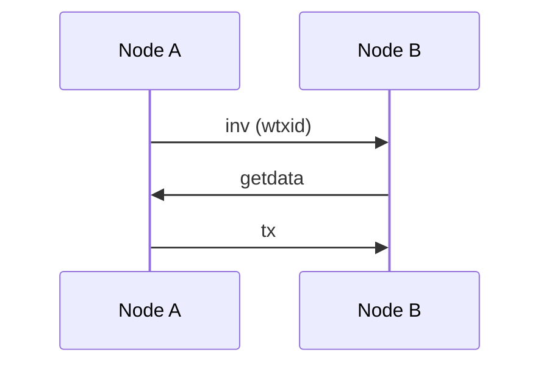

# SplytWiki components for technical articles

Everything here works on GitHub Pages' standard Jekyll: no custom Ruby plugins, no build step. External libraries load from jsDelivr **only on pages that use them**, so ordinary articles stay as light as before.

| Component | How to use it | Loads extra code? |
|---|---|---|
| [Math](#1-math) | `math: true` + `$$…$$` | KaTeX (~280 KB), only with `math: true` |
| [Code](#2-code) | fenced block with a language | No (Rouge runs at build time) |
| [Pinned source excerpt](#3-pinned-source-excerpt) | `` above a fenced block | No |
| [Diagrams](#4-diagrams) | fenced block with language `mermaid` | Mermaid ES module (~80 KB core plus the chunks for that diagram type), only when a diagram is near the viewport |
| [Callouts](#5-callouts) | `` | No |
| [Verified badge, difficulty, prerequisites](#6-verified-badge-difficulty-and-prerequisites) | front matter | No |
| [Heading anchors](#7-heading-anchors) | automatic | No |
| [Protocol infobox fields](#8-protocol-infobox-fields) | `infobox.protocol` in front matter | No |

---

## 1. Math

Add `math: true` to the front matter. [`_includes/math.html`](../_includes/math.html) then loads KaTeX 0.16.11 and its auto-render extension.

**Write maths with `$$…$$`.** kramdown recognises it and protects its contents from Markdown, so `_`, `*` and `\` survive:

- **Display:** `$$…$$` on its own line, with a blank line before and after. kramdown outputs `\[…\]`.
- **Inline:** `$$…$$` inside a sentence. kramdown outputs `\(…\)`.
- **Plain `$…$`** also renders inline, but kramdown does not protect it. Use it only for simple symbols with no `_`, `*` or `\`, such as `$i$`.

```markdown
---
math: true
---

The total subsidy is

$$S = 210\,000 \times \sum_{i=0}^{32} \left\lfloor \frac{50 \times 10^{8}}{2^{i}} \right\rfloor$$

where $$S$$ is in satoshis and $i$ is the halving era.

A slashed validator's correlation penalty is

$$p = \frac{3 \cdot s_{\text{slashed}}}{s_{\text{total}}} \times b_{\text{eff}}$$
```

Keep the variables list directly under each display formula (`docs/STYLE.md` §4). Wide formulas scroll sideways on phones instead of overflowing.

## 2. Code

Fenced code blocks are highlighted by Rouge at build time. Supported and tested: `cpp`, `go`, `rust`, `python`, `solidity`, `bash`, `json`, `yaml`. Readers get a **Copy** button on hover (always shown on touch screens).

````markdown
```rust
fn main() { println!("hello"); }
```
````

Use `text` for output or for formats Rouge does not know.

## 3. Pinned source excerpt

Put [`_includes/source-code.html`](../_includes/source-code.html) directly above the fenced block. It renders a header bar: repository · file path · lines · pinned tag · licence. Each part links to the exact GitHub permalink, `github.com/OWNER/REPO/blob/<TAG-OR-SHA>/path#Lx-Ly`.

````markdown


```cpp
CAmount GetBlockSubsidy(int nHeight, const Consensus::Params& consensusParams)
{
    …
}
```
````

| Parameter | Required | Meaning |
|---|---|---|
| `repo` | yes | `owner/repo` on GitHub |
| `path` | yes | file path inside the repository |
| `ref` | yes | **a tag or a full commit hash, never a branch** (`master`, `main`) |
| `lines` | no | `1843-1854` or a single line `1843` |
| `license` | no | upstream licence, e.g. `MIT` |
| `host` | no | defaults to `https://github.com` |

The excerpt must be copied from the file at that ref, fetched during the session (`CLAUDE.md` §4).

## 4. Diagrams

Use a fenced block with the language `mermaid`. `splytwiki.js` loads Mermaid 10.9.1 only when a diagram is within about 400 px of the viewport. It renders in the site's light or dark colours and re-renders when the reader switches theme. Without JavaScript, the diagram source stays readable.

````markdown

````

Good fits:

- `sequenceDiagram` for P2P message flows.
- `timeline` for upgrade histories.
- `stateDiagram-v2` for channel or validator states.
- `flowchart` for validation pipelines.

Keep labels short so diagrams fit on a phone.

## 5. Callouts

[`_includes/callout.html`](../_includes/callout.html) draws a boxed note with an icon and a restrained colour:

```liquid

```

| `type` | Label | Use for |
|---|---|---|
| `tradeoff` | Trade-off | A cost paid for a benefit, with numbers |
| `attack` | Attack vector | A concrete attack: mechanism, precondition, impact, incident |
| `limitation` | Known limitation | What the mechanism cannot do |
| `debate` | Design debate | An open or historical dispute with named sides; link the debate case file |
| `implementation` | Implementation note | Client-specific behaviour, defaults, flags |
| `changed` | Changed in *version* | A behaviour change; add `version="Bitcoin Core v28.0"` |
| `deprecated` | Deprecated in *version* | A removed or deprecated feature; add `version="…"` |

`title` is optional. `content` is Markdown on one line, and footnote markers inside it link to the article's References. Use `&quot;` for a double quote inside `content`.

## 6. Verified badge, difficulty and prerequisites

These front-matter fields drive a line under the article title ([`_includes/article-meta.html`](../_includes/article-meta.html)):

```yaml
verified_against: "Bitcoin Core v31.1"
last_verified: 2026-10-23
difficulty: advanced            # intro | intermediate | advanced
prerequisites: [Bitcoin, UTXO]  # article slugs
```

- **Verified against Bitcoin Core v31.1 on 23 October 2026.** The badge turns amber and adds "may be outdated" when `last_verified` is more than 12 months old. This is checked at build time and again in the reader's browser.
- The **difficulty pill** is green for Intro, blue for Intermediate and red for Advanced.
- **Prerequisites** link each slug to its article; a missing article shows as a red link.

All fields default to empty in `_config.yml`, and nothing renders when they are empty.

## 7. Heading anchors

Every `##` and `###` heading gets a ¶ link on hover, or always faintly on touch screens. Copy it to deep-link a section in chat or a GitHub issue, for example `…/wiki/Bitcoin_halving/#supply-limit`. Nothing to add in Markdown.

## 8. Protocol infobox fields

For protocol articles, add a `protocol:` map to the infobox. It renders as a "Protocol" section after the normal rows:

```yaml
infobox:
  image: bitcoin.svg
  rows:
    - header: Overview
    - Type: Soft fork
  protocol:
    spec: "[BIP-341](https://github.com/bitcoin/bips/blob/<COMMIT>/bip-0341.mediawiki)"
    reference_implementation: "[Bitcoin Core](https://github.com/bitcoin/bitcoin/tree/v31.1)"
    other_implementations: "btcd, libbitcoin"
    activated: "Block 709,632 (14 November 2021)"
    superseded_by: "—"
```

Any subset of the five keys works. `header:` inside `protocol` overrides the section title.

## Demo

[Bitcoin halving](../_wiki/Bitcoin_halving.md) uses maths, a Mermaid timeline, a pinned source excerpt, a Design-debate callout and the verified badge.
